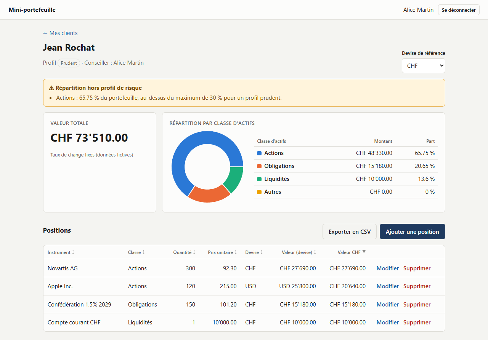
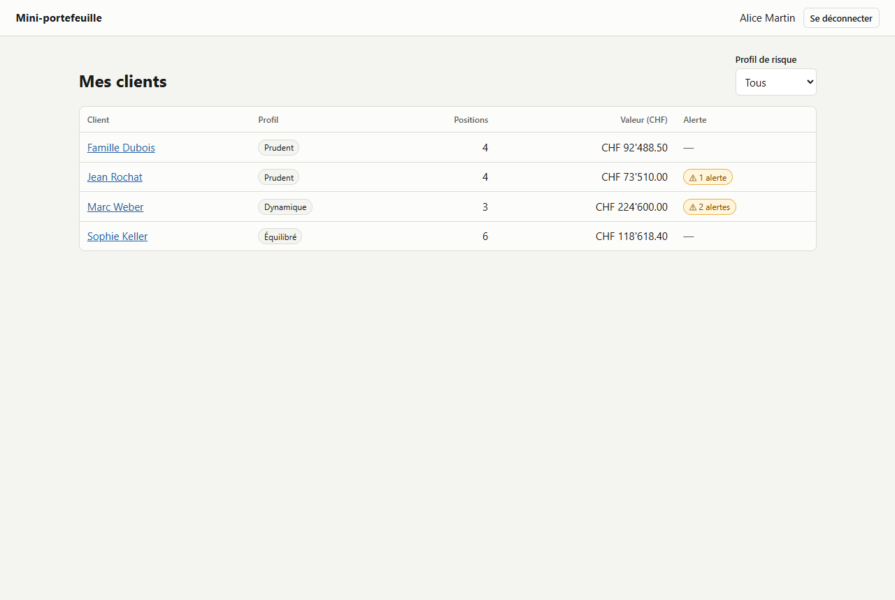
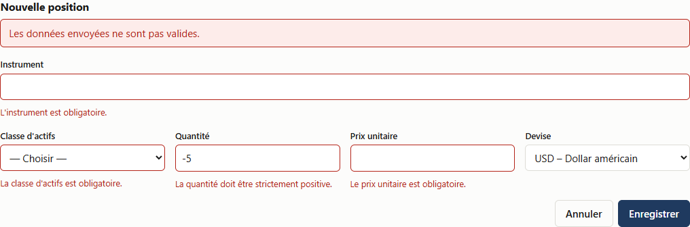

# Mini-portefeuille

Petite application qui permet à un conseiller en patrimoine de consulter le portefeuille de ses
clients : valeur totale dans une devise de référence, répartition par classe d'actifs, alerte
quand la répartition s'écarte du profil de risque, et gestion des positions.

Exercice technique réalisé pour le poste de Développeur IT (.NET / React) chez Piguet Galland.
Toutes les données sont fictives.

**Stack** : .NET 10 · ASP.NET Core · EF Core 10 · PostgreSQL 17 · React 19 + TypeScript · Vite ·
Recharts · xUnit · Vitest + Testing Library · Docker Compose · GitHub Actions

---

## Lancement en une commande

```bash
docker compose up --build
```

Puis ouvrir **http://localhost:8080**.

| Conseiller | Identifiant | Mot de passe | Clients |
|---|---|---|---|
| Alice Martin | `amartin` | `Demo-2026!` | 4 clients, dont 2 en alerte |
| Bruno Nguyen | `bnguyen` | `Demo-2026!` | 3 clients, dont un sans position |

Les deux conseillers permettent de vérifier le cloisonnement : aucun ne voit les clients de l'autre.

Aucun fichier `.env` n'est nécessaire. Pour fixer la clé JWT ou le mot de passe de la base, copier
`.env.example` en `.env` (ignoré par Git).

### Sans Docker (développement)

Prérequis : SDK .NET 10 et Node 24. L'API utilise alors SQLite (`portfolio-dev.db`), créée et
chargée automatiquement au démarrage.

```bash
dotnet run --project src/Portfolio.Api --launch-profile http
```

```bash
npm --prefix src/web install
```

```bash
npm --prefix src/web run dev
```

Front sur http://localhost:5173 (le serveur Vite relaie `/api` vers l'API sur le port 5215).

### Tests

```bash
dotnet test
```

```bash
npm --prefix src/web test
```

---

## Captures d'écran

**Fiche client** : alerte de répartition, valeur totale, graphique, tableau triable.



**Liste des clients**, filtrable par profil de risque :



**Erreurs de validation** renvoyées par l'API et affichées sous chaque champ :



Les captures sont produites par `src/web/scripts/screenshots.mjs` (Playwright).

---

## Fonctionnalités

| Demandé | Où |
|---|---|
| Lister les clients du conseiller connecté, filtre par profil | `GET /api/clients?riskProfile=Prudent` · page « Mes clients » (filtre conservé dans l'URL) |
| Détail d'un client et ses positions | `GET /api/clients/{id}` |
| Valeur totale dans une devise (CHF par défaut) et répartition en montant et en % | `GET /api/clients/{id}/valuation?currency=EUR` |
| Ajouter, modifier, supprimer une position, avec validation | `POST` / `PUT` / `DELETE /api/clients/{id}/positions[/{positionId}]` |
| Alerte si la répartition s'écarte du profil | incluse dans la valorisation, affichée dans la fiche et comptée dans la liste |
| Page de connexion, liste, fiche, formulaire avec erreurs de l'API | `src/web/src/pages`, `src/web/src/components` |
| **Bonus** : journal d'audit des modifications de positions | table `position_audit`, écrite dans la même transaction que la modification |
| **Bonus** : export CSV d'un portefeuille | `GET /api/clients/{id}/export.csv` · bouton « Exporter en CSV » |

### Règles d'alerte

Bornes incluses, comparées au pourcentage arrondi affiché au conseiller. Un portefeuille vide ne
déclenche pas d'alerte.

| Profil | Actions | Liquidités | Autres |
|---|---|---|---|
| Prudent | ≤ 30 % | | ≤ 10 % |
| Équilibré | 20 % à 60 % | | ≤ 20 % |
| Dynamique | ≥ 50 % | ≤ 25 % | |

Les valeurs sont volontairement simples et vivent dans un seul fichier
(`src/Portfolio.Domain/Alerts/AllocationPolicy.cs`). Dans un vrai contexte, elles viendraient de
la politique d'investissement et seraient paramétrables.

---

## Architecture

```
src/
  Portfolio.Domain          Entités, calcul de valorisation, règles d'alerte. Aucune dépendance.
  Portfolio.Application     Cas d'usage (clients, positions, authentification), validation, DTO.
                            Accède aux données via le port IPortfolioDbContext.
  Portfolio.Infrastructure  EF Core (PostgreSQL ou SQLite), migrations, jeu d'essai.
  Portfolio.Api             Contrôleurs REST, JWT, ProblemDetails, limitation des connexions.
  web/                      Front React + TypeScript (Vite), servi par nginx en conteneur.
tests/
  Portfolio.UnitTests         Valorisation, change, alertes, validation, export CSV.
  Portfolio.IntegrationTests  API complète en mémoire (WebApplicationFactory + SQLite).
```

Dépendances : `Api → Infrastructure → Application → Domain`.

### Choix et raisons

- **Le calcul de valorisation est une fonction pure** (`PortfolioValuator.Value`). Il reçoit des
  positions et une table de taux, et ne dépend ni de la base ni de l'horloge. Les tests portent
  sur cette fonction sans aucune infrastructure.
- **Précision monétaire.** Tout est en `decimal`. La conversion passe toujours par le CHF
  (`montant × taux source ÷ taux cible`). On arrondit une seule fois, à la fin, à 2 décimales
  (au plus proche, 0.5 vers l'extérieur). Arrondir position par position fausserait les totaux.
  Conséquence assumée : trois tiers s'affichent 33.33 % chacun, soit 99.99 % au total.
  Les quantités et les prix sont stockés en `numeric(18,6)` et les taux en `numeric(18,8)`.
- **Cloisonnement par conseiller dans chaque requête.** L'identifiant du conseiller vient
  uniquement du claim `sub` du jeton, jamais de l'URL ni du corps de la requête. Un client d'un
  autre conseiller renvoie **404 et non 403**, pour ne pas confirmer qu'il existe. Une position
  doit aussi appartenir au client de l'URL. J'ai préféré des filtres explicites et testés à un
  filtre global EF, qui est plus discret mais plus facile à contourner sans s'en rendre compte
  (`IgnoreQueryFilters`, requêtes SQL brutes).
- **Résultats plutôt qu'exceptions** pour les cas attendus. Les services renvoient un
  `Result<T>` (Ok, NotFound ou Invalid avec les erreurs par champ), que l'API traduit en 200,
  404 ou 400 `ValidationProblemDetails`. Les exceptions restent réservées à l'imprévu
  (500 ProblemDetails, sans détail technique).
- **Validation côté API, messages exploitables par le front.** Le corps de requête accepte des
  champs nullables et une classe d'actifs sous forme de texte. Ainsi, c'est le validateur qui
  produit un message par champ, et non la désérialisation JSON. Les erreurs de format JSON sont
  aussi réécrites (`$.quantity` devient `quantity`, sans nom de type .NET). Le front affiche ces
  erreurs telles quelles sous chaque champ.
- **Audit transactionnel.** Créer une position puis son entrée d'audit demande deux `SaveChanges`
  (l'audit a besoin de l'identifiant généré). Les deux sont donc dans une transaction explicite.
- **PostgreSQL en conteneur, SQLite en local et en tests.** On choisit le fournisseur par
  configuration. PostgreSQL utilise les migrations EF. La CI vérifie que la migration est à jour
  avec le modèle (`has-pending-model-changes`).
- **Front.** L'état reste local aux pages, avec un petit hook `useAsync` qui ignore les réponses
  périmées. Je n'ai pas ajouté de librairie d'état : il n'y a pas d'état partagé hormis la
  session. Le filtre de profil vit dans l'URL. La fiche client, qui embarque Recharts, est
  chargée à la demande. Le graphique a une légende chiffrée qui sert aussi de tableau : la
  couleur n'est jamais la seule information.

---

## Sécurité

- **JWT HS256** : émetteur, audience, durée de vie (60 min) et algorithme vérifiés, décalage
  d'horloge limité à 30 s. Le front se déconnecte à l'expiration ou sur un 401.
- **Mots de passe** hachés avec `PasswordHasher` d'ASP.NET Core Identity (PBKDF2). À la
  connexion, on vérifie un hachage factice même si l'utilisateur n'existe pas, pour que le temps
  de réponse ne révèle pas les identifiants valides. Le message d'erreur est le même dans les
  deux cas.
- **Limitation des tentatives de connexion** : 10 par minute et par adresse IP.
- **Aucun secret dans le dépôt.** La clé JWT est lue dans l'environnement (`Jwt__SigningKey`).
  Si elle manque hors production, l'API génère une clé aléatoire à chaque démarrage. En
  production, une clé absente ou trop courte (< 256 bits) empêche le démarrage. La base n'est pas
  exposée hors du réseau Docker.
- **Conteneurs sans root** : image `aspnet` avec `APP_UID`, `nginx-unprivileged`. nginx ajoute
  des en-têtes de sécurité (CSP stricte, `X-Frame-Options`, `nosniff`, `Referrer-Policy`).
- **Export CSV protégé contre l'injection de formules** : une cellule qui commence par
  `= + - @` est préfixée d'une apostrophe.

---

## CI/CD

`.github/workflows/ci.yml`, à chaque push et pull request :

1. **API** : restauration, build Release, vérification des migrations, tests unitaires et
   d'intégration (résultats et couverture publiés en artefacts).
2. **Front** : `npm ci`, lint (oxlint), contrôle de types, tests Vitest, build.
3. **Docker** : construction des images, `docker compose up`, puis test de fumée à travers nginx
   (connexion, liste des clients, page d'accueil), puis `docker compose down`.

---

## Usage des outils d'IA

Le projet a été développé avec **Claude Code** (Anthropic), en mode agent. Je décrivais
l'architecture et les règles métier attendues. L'outil générait le code, le compilait, lançait
les tests et l'application, et j'ai relu et validé les choix.

Problèmes repérés pendant le développement, et corrigés :

| Constat | Comment il a été repéré | Correction |
|---|---|---|
| La création d'une position et de son entrée d'audit tenait en deux `SaveChanges` non atomiques | Relecture | Transaction explicite |
| Les erreurs de JSON mal formé exposaient le type .NET et la position dans le flux (`Portfolio.Application.Positions.PositionRequest… BytePositionInLine`) | Appel manuel de l'API | Fabrique de réponse personnalisée, plus un test d'intégration |
| Un message disait « La quantité doit être strictement positif » | Appel manuel de l'API | Accord par champ, vérifié par un test |
| Les quantités revenaient `20.0` (SQLite) ou `20.000000` (PostgreSQL), ce qui faussait l'audit | Test d'intégration en échec | Normalisation des décimales dans les DTO et l'audit |
| `fr-CH` formate les montants avec un point et les nombres avec une virgule : la fiche mélangeait `48 330.00` et `65,75 %` | Vérification visuelle dans le navigateur | Convention suisse `de-CH` partout (`CHF 48'330.00`, `65.75 %`), également dans les messages d'alerte de l'API |
| Hook de chargement qui appelait `setState` dans un effet (rendus en cascade) | Lint (oxlint) | État « chargement » dérivé |
| Bundle de 600 kB | Avertissement de build | Fiche client (Recharts) chargée à la demande |
| Saisie non numérique envoyée comme champ vide, d'où le message « obligatoire » trompeur | Relecture | Contrôle local du format, avec un test |

Vérifié à la main : les chiffres de la valorisation de Jean Rochat (recalculés à la main, puis
fixés dans un test d'intégration), le cloisonnement entre les deux conseillers, l'affichage des
erreurs et le comportement à l'expiration de la session.

---

## Limites connues

- **Taux de change fixes** et prix saisis à la main : pas de données de marché, pas d'historique.
- **Jeton en `sessionStorage`** : il est lisible par du JavaScript injecté en cas de faille XSS.
  La CSP limite ce risque, mais un cookie `HttpOnly` + `SameSite` serait préférable en production.
  Il n'y a pas de jeton de rafraîchissement : la session expire au bout de 60 minutes.
- **Limitation des connexions derrière nginx** : l'API voit l'adresse du proxy, donc la limite
  porte sur tous les utilisateurs ensemble. Il faudrait `ForwardedHeaders` en ne faisant
  confiance qu'au proxy.
- **Tests d'intégration sur SQLite**, pas sur PostgreSQL. Le comportement SQL réel (types,
  collation) n'est couvert que par le test de fumée Docker en CI.
- **La liste des clients charge leurs positions** pour afficher valeur et alertes. C'est adapté à
  quelques dizaines de clients. Au-delà, il faudrait de la pagination et une valorisation
  précalculée.
- **Pas de contrôle de concurrence** sur les positions : la dernière écriture l'emporte.
- **Journal d'audit sans écran de consultation** : il est uniquement en base.
- HTTPS non géré par le compose : à terminer en amont (reverse proxy ou ingress).

## Prochaines étapes envisagées

1. Tests d'intégration sur un vrai PostgreSQL via Testcontainers.
2. Jeton de concurrence (`xmin` PostgreSQL) sur les positions, avec 409 côté API.
3. Écran d'historique des modifications (journal d'audit) et historique de valorisation.
4. Cookie `HttpOnly`, jeton de rafraîchissement, `ForwardedHeaders`.
5. Publication des images sur GHCR et déploiement sur un hébergement gratuit.
6. Politique d'allocation paramétrable par la banque plutôt que codée.
